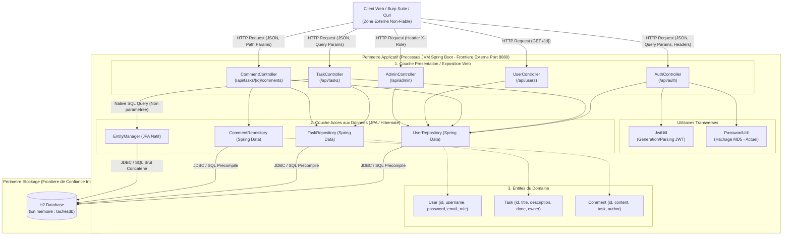
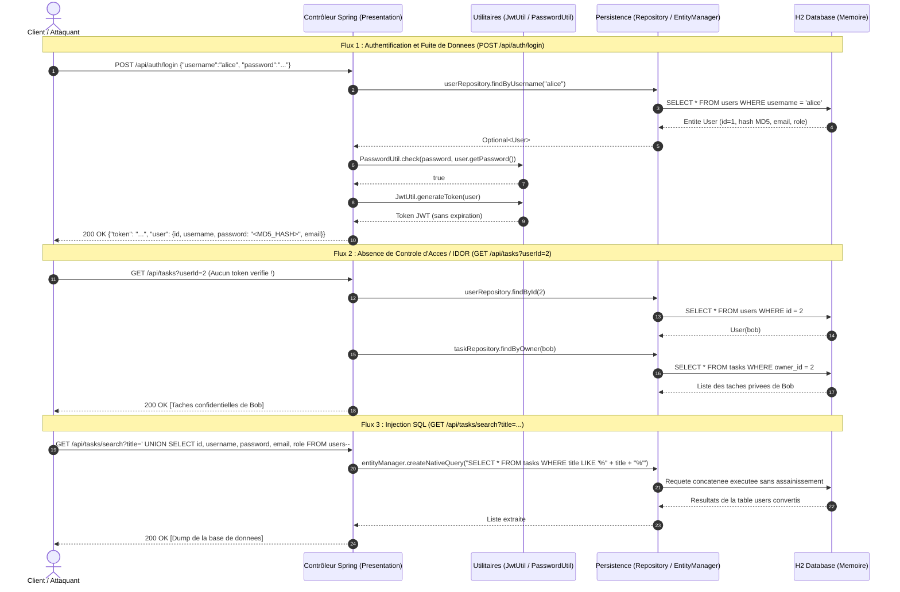

# Projet Integrateur DevSecOps - Dossier Technique et Architecture

Ce document presente la description technique complete du projet, l'architecture logicielle, les mecanismes de communication inter-couches, la pile technologique (tech stack), ainsi que la cartographie des vulnerabilites et la feuille de route du projet.

---

## 1. Description du Projet et Contexte

### 1.1 Contexte Academique
Le projet s'inscrit dans le cadre du module **Securite des SI et Cybersecurite** (3ACI INFO GL / 5e annee Genie Logiciel, Universite Mundiapolis).
Il s'agit d'un projet integrateur reposant sur une API web reellement fonctionnelle, distribuee deliberement avec un ensemble de defauts de securite representatifs des failles applicatives majeures (OWASP Top 10, CWE).

### 1.2 Objectif Fonctionnel
L'application cible, nommee **API Taches** ([api-taches-etudiants](file:///home/youssef/Projects/academic/security/final-project/api-taches-etudiants)), est un service backend RESTful de gestion collaborative de taches etudiantes. Elle offre les fonctionnalites suivantes :
- **Gestion des comptes et authentification** : Inscription d'etudiants, connexion avec generation de jetons JWT.
- **Gestion du cycle de vie des taches** : Creation, consultation, recherche par mot-cle, suppression de taches liees a un proprietaire.
- **Systeme de commentaires** : Echanges et retours textuels attaches a une tache donnee.
- **Administration** : Consultation globale de l'annuaire des utilisateurs et de leurs privileges.

### 1.3 Objectif Pedagogique et Demarche DevSecOps
Contrairement a un developpement partant d'une page blanche, le travail s'articule autour de trois actions cardinales :
1. **Auditer** : Analyser l'architecture, modeliser les menaces (STRIDE), tester dynamiquement les surfaces d'attaque via Burp Suite et tracer les causes racines au niveau du code source.
2. **Corriger** : Remiser les failles sans alterer le fonctionnement nominal de l'application, migrer la cryptographie vers des standards robustes (BCrypt/Argon2), epurer le code et l'historique Git des secrets en dur.
3. **Prouver** : Fournir des preuves d'exploitation reproductibles (Proof of Concept - PoC) avant correction, puis demontrer l'echec de l'attaque apres remédiation tout en validant la non-regression fonctionnelle.

---

## 2. Pile Technologique (Tech Stack)

| Composant | Technologie retenue | Version / Specification | Role et Justification |
|---|---|---|---|
| **Langage** | Java | 17 / 21 LTS | Langage de programmation fortement type execute sur la JVM. |
| **Framework Web & IoC** | Spring Boot | 3.3.4 | Socle applicatif assurant l'injection de dependances, la configuration automatique et l'exposition REST. |
| **Couche Web / MVC** | Spring Web | 3.3.4 (Jakarta Servlet API, Jackson) | Routage HTTP, serialisation et deserialisation des payloads JSON via Jackson. |
| **Couche de Persistance** | Spring Data JPA / Hibernate | Jakarta Persistence 3.1 | ORM (Object-Relational Mapping) traduisant les entites Java en tables relationnelles et executant les requetes SQL. |
| **Base de Donnees** | H2 Database Engine | Embarquee (`jdbc:h2:mem:tachesdb`) | Base relationnelle legere en memoire s'initialisant au demarrage via `data.sql`. Fournit une console web de debogage (`/h2-console`). |
| **Gestion des Tokens** | JJWT (Java JWT) | 0.11.5 (`jjwt-api`, `jjwt-impl`, `jjwt-jackson`) | Generation et validation cryptographique des jetons stateless JSON Web Tokens. |
| **Gestionnaire de Build** | Apache Maven | Maven Wrapper (`mvnw`) | Automatisation de la compilation, resolution des dependances et packaging de l'artefact jar. |
| **Outil d'Audit Dynamique** | PortSwigger Burp Suite | Community Edition | Proxy d'interception HTTP, analyseur de requetes (Repeater, Intruder) pour l'audit applicatif (DAST). |

---

## 3. Architecture Systeme et Frontieres de Confiance

Le systeme est concu selon une architecture en couches (Layered Architecture). Le schema ci-dessous met en evidence les flux de donnees ainsi que les deux frontieres de confiance critiques.

---

## 4. Communication Inter-Couches : Mecanismes et Protocoles

### 4.1 De la Requete HTTP a la Reponse : Cycle de Vie Standard
La communication suit une trajectoire descendante, puis ascendante :

1. **Requete entrante (Client vers Couche Presentation) :**
   - **Protocole :** HTTP/1.1 via TCP sur le port `8080`.
   - **Format de transfert :** JSON (`application/json`) pour les corps de requetes (`POST`), parametres d'URL (`@RequestParam`), ou variables de chemin (`@PathVariable`).
   - **En-tetes sensibles :** `X-Role` pour la verification de privileges d'administration, ou absence notable du standard `Authorization: Bearer <token>`.

2. **Traitement au niveau Contrôleur :**
   - Les methodes des contrôleurs extraient les parametres bruts issus de la requete sans couche de validation formelle (`@Valid`, Bean Validation).
   - Les donnees sont transmises aux methodes d'utilitaires (`PasswordUtil`, `JwtUtil`) ou directement aux interfaces de repository Spring Data.

3. **Couche Presentation vers Couche Persistance :**
   - Communication en memoire JVM via des appels de methodes d'interfaces Java (proxies Spring Data JPA).
   - Les entites de persistance (`User`, `Task`, `Comment`) sont manipulees directement comme objets de transfert de donnees (pas d'abstraction par DTO).

4. **Couche Persistance vers Base de Donnees :**
   - **Protocole :** JDBC (Java Database Connectivity) local en memoire (`jdbc:h2:mem:tachesdb`).
   - Deux mecanismes distincts coexistent :
     - Requetes automatiques generees par Spring Data JPA (ex: `findByOwner`, `findById`).
     - Requetes natives brutes executees via l'`EntityManager` (ex: `entityManager.createNativeQuery(sql, Task.class)`).

5. **Reponse sortante (Couche Presentation vers Client) :**
   - Les entites de base de donnees sont serialisees directement en JSON par le moteur Jackson et renvoyees au client au format HTTP 200 OK, 400 Bad Request, 401 Unauthorized, 403 Forbidden ou 404 Not Found.

### 4.2 Diagramme de Sequence : Authentification, IDOR et Injection SQL

Le diagramme de sequence suivant illustre trois flux reels au travers des couches logicielles, mettant en evidence les echanges de donnees et les zones de rupture de securite.

---

## 5. Inventaire des Composants du Code Source

### 5.1 Package Presentation (`com.mundiapolis.taches.web`)
- [`AuthController`](file:///home/youssef/Projects/academic/security/final-project/api-taches-etudiants/src/main/java/com/mundiapolis/taches/web/AuthController.java) : Gere l'inscription (`/register`) et la connexion (`/login`). Renvoie l'entite `User` entiere avec le mot de passe hache.
- [`TaskController`](file:///home/youssef/Projects/academic/security/final-project/api-taches-etudiants/src/main/java/com/mundiapolis/taches/web/TaskController.java) : Expose le CRUD des taches. Heberge une faille critique d'injection SQL (`/search`) et des failles BOLA/IDOR sur les acces et suppressions.
- [`CommentController`](file:///home/youssef/Projects/academic/security/final-project/api-taches-etudiants/src/main/java/com/mundiapolis/taches/web/CommentController.java) : Gere l'ajout et l'affichage des commentaires. Enregistre du contenu textuel arbitraire non assaini (vecteur XSS stocke).
- [`UserController`](file:///home/youssef/Projects/academic/security/final-project/api-taches-etudiants/src/main/java/com/mundiapolis/taches/web/UserController.java) : Consultation du profil utilisateur (`/{id}`). Fuite directe des attributs de compte sans authentification.
- [`AdminController`](file:///home/youssef/Projects/academic/security/final-project/api-taches-etudiants/src/main/java/com/mundiapolis/taches/web/AdminController.java) : Route administrative (`/users`). Verifie les droits uniquement par la presence de l'en-tete HTTP `X-Role: ADMIN`.

### 5.2 Package Acces aux Donnees (`com.mundiapolis.taches.repo`)
- [`UserRepository`](file:///home/youssef/Projects/academic/security/final-project/api-taches-etudiants/src/main/java/com/mundiapolis/taches/repo/UserRepository.java) : Interface JPA pour l'entite `User` (recherche par nom d'utilisateur).
- [`TaskRepository`](file:///home/youssef/Projects/academic/security/final-project/api-taches-etudiants/src/main/java/com/mundiapolis/taches/repo/TaskRepository.java) : Interface JPA pour l'entite `Task` (recherche par proprietaire).
- [`CommentRepository`](file:///home/youssef/Projects/academic/security/final-project/api-taches-etudiants/src/main/java/com/mundiapolis/taches/repo/CommentRepository.java) : Interface JPA pour l'entite `Comment` (recherche par tache).

### 5.3 Package Entites (`com.mundiapolis.taches.model`)
- [`User`](file:///home/youssef/Projects/academic/security/final-project/api-taches-etudiants/src/main/java/com/mundiapolis/taches/model/User.java) : Structure relationnelle de l'utilisateur (`id`, `username`, `password`, `email`, `role`).
- [`Task`](file:///home/youssef/Projects/academic/security/final-project/api-taches-etudiants/src/main/java/com/mundiapolis/taches/model/Task.java) : Tache avec relation `ManyToOne` vers `User` (`owner`).
- [`Comment`](file:///home/youssef/Projects/academic/security/final-project/api-taches-etudiants/src/main/java/com/mundiapolis/taches/model/Comment.java) : Commentaire associe a une `Task` et un `User` (`author`).

### 5.4 Package Utilitaires (`com.mundiapolis.taches.util`)
- [`PasswordUtil`](file:///home/youssef/Projects/academic/security/final-project/api-taches-etudiants/src/main/java/com/mundiapolis/taches/util/PasswordUtil.java) : Implementation obsolete basee sur l'algorithme `MD5` sans salage.
- [`JwtUtil`](file:///home/youssef/Projects/academic/security/final-project/api-taches-etudiants/src/main/java/com/mundiapolis/taches/util/JwtUtil.java) : Gestionnaire JWT incomplet (cle symetrique triviale, absence de champ `exp` / expiration).

---

## 6. Cartographie Initiale des Vulnerabilites Identifiees

| Categorie OWASP | Composant / Fichier | Ligne / Mecanisme | Description de la Vulnerabilite | Impact Technique |
|---|---|---|---|---|
| **A03:2021 - Injection** | [`TaskController.java`](file:///home/youssef/Projects/academic/security/final-project/api-taches-etudiants/src/main/java/com/mundiapolis/taches/web/TaskController.java#L86-L91) | Ligne 88 : `SELECT * FROM tasks WHERE title LIKE '%" + title + "%'` | Concaténation directe d'une entree utilisateur dans une requete SQL native. | Extraction integrale de la base de donnees (comptes, mots de passe) ou alteration de donnees via UNION SQLi. |
| **A01:2021 - Broken Access Control (BOLA/IDOR)** | [`TaskController.java`](file:///home/youssef/Projects/academic/security/final-project/api-taches-etudiants/src/main/java/com/mundiapolis/taches/web/TaskController.java#L43-L50) | Lignes 44, 68, 77 | Absence totale de validation du porteur du token JWT face au `userId` ou `taskId` demande. | N'importe quel utilisateur ou attaquant non authentifie peut lire ou supprimer les taches de tiers. |
| **A01:2021 - Broken Access Control** | [`AdminController.java`](file:///home/youssef/Projects/academic/security/final-project/api-taches-etudiants/src/main/java/com/mundiapolis/taches/web/AdminController.java#L27-L30) | Ligne 28 : `!"ADMIN".equals(role)` | Verification de privilege deleguee a un en-tete client arbitraire (`X-Role`). | Elevation immediate de privileges administrateur par injection d'en-tete HTTP (`X-Role: ADMIN`). |
| **A02:2021 - Cryptographic Failures** | [`PasswordUtil.java`](file:///home/youssef/Projects/academic/security/final-project/api-taches-etudiants/src/main/java/com/mundiapolis/taches/util/PasswordUtil.java#L10-L22) | Ligne 12 : `MessageDigest.getInstance("MD5")` | Algorithme de hachage casse (MD5) utilise sans sel cryptographique. | Cassage instantane des empreintes via tables de hachage inversees (Rainbow Tables). |
| **A07:2021 - Identification & Auth Failures** | [`JwtUtil.java`](file:///home/youssef/Projects/academic/security/final-project/api-taches-etudiants/src/main/java/com/mundiapolis/taches/util/JwtUtil.java#L22-L30) | Lignes 23-29 | Absence de date d'expiration (`setExpiration`) sur les jetons JWT. | Les tokens generes sont valides indefiniment ; impossible d'invalider une session compromise. |
| **A03:2021 - Injection (Stored XSS)** | [`CommentController.java`](file:///home/youssef/Projects/academic/security/final-project/api-taches-etudiants/src/main/java/com/mundiapolis/taches/web/CommentController.java#L47-L59) | Ligne 56 : `new Comment(body.get("content"), ...)` | Stockage de chaines HTML/JavaScript sans assainissement ni encodage en sortie. | Execution de scripts malveillants dans le contexte de navigation d'autres utilisateurs consultant les commentaires. |
| **A01:2021 - Sensitive Data Exposure** | [`AuthController.java`](file:///home/youssef/Projects/academic/security/final-project/api-taches-etudiants/src/main/java/com/mundiapolis/taches/web/AuthController.java#L56) / [`UserController.java`](file:///home/youssef/Projects/academic/security/final-project/api-taches-etudiants/src/main/java/com/mundiapolis/taches/web/UserController.java#L31) | Reponses HTTP | Serialisation directe de l'objet `User` complet renvoyant le hash de mot de passe et l'email. | Fuite massive de donnees a caractere personnel et d'empreintes d'authentification. |
| **A05:2021 - Security Misconfiguration** | [`application.properties`](file:///home/youssef/Projects/academic/security/final-project/api-taches-etudiants/src/main/resources/application.properties#L17-L20) | Lignes 17, 19, 20 | Cle secrete JWT hardcodee, `server.error.include-stacktrace=always`, CORS ouvert a tous les domaines (`*`). | Fuite d'informations systeme internes par stack traces et possibilite de falsification globale de jetons. |

---

## 7. Structure des Jalons du Projet (Roadmap et Livrables)

Le projet s'echelonne sur trois jalons majeurs et une soutenance finale :

```mermaid
flowchart LR
    subgraph J1["Jalon 1 (Semaine du 26 Octobre 2026)"]
        direction TB
        J1_1["Modelisation des menaces"]
        J1_2["Schema d'architecture"]
        J1_3["Tableau STRIDE complet"]
        J1_4["Priorisation (Impact x Probabilite)"]
    end

    subgraph J2["Jalon 2 (Semaine du 23 Novembre 2026)"]
        direction TB
        J2_1["Rapport d'audit de securite"]
        J2_2["Tests dynamiques Burp Suite"]
        J2_3["Minimum 8 failles documentees"]
        J2_4["PoC reproductibles et code incrimine"]
    end

    subgraph J3["Jalon 3 (Semaine du 21 Decembre 2026)"]
        direction TB
        J3_1["Code source assaini et securise"]
        J3_2["Migration cryptographique (BCrypt/Argon2)"]
        J3_3["Verification de non-regression"]
        J3_4["Rapport de conformite RGPD"]
        J3_5["Soutenance finale (Session 14)"]
    end

    J1 --> J2 --> J3
```

### 7.1 Jalon 1 (J1) : Modelisation des Menaces
- **Livrable :** Dossier de modelisation (Markdown/PDF versionne sous `docs/`).
- **Contenu exige :**
  - Schema d'architecture avec flux de donnees et frontieres de confiance.
  - Matrice STRIDE complete (Spoofing, Tampering, Repudiation, Information Disclosure, Denial of Service, Elevation of Privilege) avec au moins un scenario detaille par categorie.
  - Calcul du score de risque (Impact $\times$ Probabilite) et plan d'audit priorise.

### 7.2 Jalon 2 (J2) : Rapport d'Audit et Preuves d'Exploitation
- **Livrable :** Rapport technique d'audit de securite (`docs/audit.md`).
- **Contenu exige :**
  - 6 familles testees : Injections SQL, XSS, Authentification/Sessions, Securite des JWT, Controle d'acces (BOLA/IDOR), Exposition de donnees.
  - Au minimum 8 failles documentees avec rigueur : URL d'endpoint, classe et numero de ligne, vecteur d'attaque, capture et requete HTTP brute (Burp Suite Repeater), reponse observee et CVSS.
  - Reproductibilite stricte des preuves d'attaque.

### 7.3 Jalon 3 (J3) : Remédiation, Cryptographie et Conformite
- **Livrable :** Code source securise sur le depot Git, rapport RGPD, rapport de non-regression.
- **Contenu exige :**
  - Correction de l'ensemble des failles identifiees avec preuve du avant / apres (rejeu de l'attaque Burp qui doit desormais echouer).
  - Remplacement de `PasswordUtil` par `BCryptPasswordEncoder` ou Argon2 avec sel automatique unique, et strategie de migration des comptes historiques.
  - Restriction CORS stricte, assainissement des en-tetes, desactivation des stack traces en production (`never`).
  - Rapport RGPD : cartographie des donnees personnelles, droit a l'effacement (droit a l'oubli), minimisation des donnees renvoyees au client (introduction de DTOs).

---

## 8. Organisation des Groupes et Grille d'Evaluation

### 8.1 Repartition des Roles et Rotation
Les equipes sont organisees en binômes/trinômes ou groupe unifie avec repartition tournante a chaque jalon :
- **Auditeur :** Conduite de la modelisation des menaces, tests dynamiques a Burp Suite, redaction des rapports d'audit.
- **Developpeur :** Correctifs du code source, remplacement de l'algorithme cryptographique, durcissement des endpoints.
- **Qualite et Conformite :** Revue de code croisee, validation de non-regression, rapport de conformite RGPD, assainissement de l'historique Git et suppression des secrets.

### 8.2 Bareme d'Evaluation Officiel

| Composante Evaluee | Jalon Associe | Ponderation | Criteres Cles |
|---|---|---|---|
| **Modelisation des Menaces** | J1 | **20 %** | Couverture complete des 6 lettres de STRIDE, scenarios credibles, schema d'architecture fidele au code, matrice de priorite. |
| **Rapport d'Audit Technique** | J2 | **30 %** | 8 failles distinctes minimum, preuves rejouables a l'identique (Burp Repeater), 6 familles couvertes, localisation code exacte. |
| **Code Corrige et Cryptographie** | J3 | **30 %** | Remediation complete prouvee (avant/apres), migration BCrypt/Argon2 avec sel unique, fonctionnement nominal preservé. |
| **Rapport RGPD et Hygiene Logicielle** | J3 | **10 %** | Droit a l'oubli, minimisation des flux, depot Git sans aucun secret, stack traces desactivees, CORS verrouille. |
| **Soutenance Orale Finale** | Session 14 | **10 %** | Maitrise individuelle des contributions, demonstration en direct face aux attaques, defense des choix techniques. |
